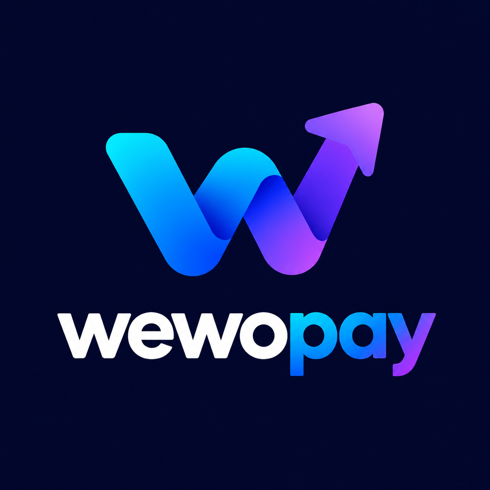

<div align="center">

  

  # WewoPay
  ### Automated Developer Escrow & Milestone Payment Platform

  [](LICENSE)
  [](https://react.dev/)
  [](https://www.typescriptlang.org/)
  [](https://vitejs.dev/)
  [](https://supabase.com/)
  [](https://paystack.com/)
  [](https://tailwindcss.com/)

  <p align="center">
    WewoPay eliminates payment friction, scope creep, and trust deficits between software engineers, agencies, and their clients through automated milestone escrows, zero-friction client portals, and automated recurring billing.
  </p>

</div>

---

## 📌 Table of Contents
- [Overview](#-overview)
- [Key Features](#-key-features)
- [Architecture & Tech Stack](#-architecture--tech-stack)
- [Project Directory](#-project-directory)
- [Getting Started](#-getting-started)
  - [Prerequisites](#prerequisites)
  - [Environment Setup](#environment-configuration)
  - [Database Setup (Supabase)](#database-setup-supabase)
  - [Edge Functions Deployment](#edge-functions-deployment)
  - [Running Locally](#running-locally)
- [Security Model](#-security-model)
- [License](#-license)

---

## 🚀 Overview

Freelancers and digital agencies frequently face delayed payouts, unapproved scope additions, and awkward payment follow-ups. Clients, on the other hand, worry about upfront deposits without tangible deliverables.

**WewoPay** solves this through a single-account Paystack gateway architecture:
1. **Developers** structure contracts into clear deliverable milestones with defined pricing and timelines.
2. **Clients** receive tokenized checkout and portal links requiring **no registration or login**.
3. **Funds** are deposited into secure escrow and automatically credited to the developer's verified balance upon client approval.

---

## ✨ Key Features

- **🛡️ Milestone Escrow Engine**: Lock client payments in escrow until deliverables are submitted, reviewed, and formally signed off.
- **🔗 Frictionless Client Portal**: Clients review progress, download receipts, and authorize stage releases without creating an account.
- **💳 Multi-Channel Checkout**: Credit/debit cards, instant bank transfers, and USSD via 256-bit encrypted Paystack checkout.
- **🔄 Recurring SaaS & Retainer Subscriptions**: Built-in support for monthly, quarterly, and annual maintenance retainers with dunning retries.
- **💸 Automated Payouts**: Verified developer payouts disbursed directly to local bank accounts via the Paystack Transfer API.
- **⚖️ Platform Administration**: Super-admin panel for commission rate controls, audit trails, and platform-wide transaction oversight.

---

## 🛠️ Architecture & Tech Stack

- **Frontend**: React 18, TypeScript, Vite, Tailwind CSS, Lucide Icons, Shadcn UI
- **Backend & Database**: Supabase (PostgreSQL with Row Level Security, Realtime, and Auth)
- **Serverless / API**: Supabase Edge Functions (Deno runtime)
- **Payment Processing**: Paystack API (Inline Checkout, Transfers & Webhooks)
- **Formatting & Quality**: Biome, TypeScript Strict Mode

---

## 📁 Project Directory

```text
├── public/                     # Static assets (Favicons, branding, SVG error graphics)
│   ├── favicon.jpg             # Browser tab icon
│   └── images/logo/Logo.png    # Primary high-res brand logo
├── src/
│   ├── components/             # Reusable UI components & layouts
│   │   ├── dashboard/          # Developer dashboard widgets & onboarding
│   │   ├── layouts/            # DashboardLayout & AdminLayout
│   │   └── ui/                 # Design system components
│   ├── contexts/               # React Contexts (AuthContext, etc.)
│   ├── db/                     # Supabase client singleton
│   ├── hooks/                  # Custom React hooks
│   ├── pages/
│   │   ├── admin/              # Master administration views
│   │   ├── auth/               # Developer Login & Signup views
│   │   ├── dashboard/          # Developer project & client management
│   │   └── public/             # Public payment & Client Portal views
│   ├── services/               # API clients & query helpers
│   ├── types/                  # TypeScript interface definitions
│   └── utils/                  # Fee calculations & Paystack utilities
├── supabase/
│   ├── functions/              # Edge Functions
│   │   ├── disburse-payout/    # Authenticated bank transfer disbursements
│   │   ├── paystack-webhook/   # HMAC-verified webhook settlement listener
│   │   └── recurring-billing/  # Automated recurring subscription cron
│   └── migrations/             # PostgreSQL migrations & RLS policies
└── docs/                       # Specifications and system architecture
```

---

## 🏁 Getting Started

### Prerequisites

- **Node.js**: `v20.x` or higher
- **Package Manager**: `pnpm` (recommended), `npm`, or `yarn`
- **Supabase CLI**: For running and deploying edge functions (`npx supabase`)
- **Accounts**: Active [Supabase](https://supabase.com) and [Paystack](https://paystack.com) accounts

### Environment Configuration

Create a `.env.local` file in the root directory (based on `.env.example`):

```bash
# Frontend Supabase Config
VITE_SUPABASE_URL=https://your-project.supabase.co
VITE_SUPABASE_ANON_KEY=your_supabase_anon_key

# Payment Gateway (Client-side)
VITE_PAYSTACK_PUBLIC_KEY=pk_test_xxxxxxxxxxxxxxxxxxxxxxxxxxxxxxxxxxxxxxxx

# Backend Secrets (Set in Supabase Edge Functions Secrets)
PAYSTACK_SECRET_KEY=sk_test_xxxxxxxxxxxxxxxxxxxxxxxxxxxxxxxxxxxxxxxx
PAYSTACK_WEBHOOK_SECRET=sk_test_xxxxxxxxxxxxxxxxxxxxxxxxxxxxxxxxxxxxxxxx
SUPABASE_SERVICE_ROLE_KEY=your_supabase_service_role_key
```

### Database Setup (Supabase)

Execute the migrations in sequential order via the **Supabase Dashboard → SQL Editor** or via the CLI:

```bash
# Apply migrations:
# 1. 00001_initial_schema.sql
# 2. 00002_execute_sql_8de89e0c.sql
# 3. 00003_security_and_atomic_functions.sql
# 4. 00004_appsec_hardening.sql
```

### Edge Functions Deployment

Deploy the serverless Edge Functions to process webhooks and handle payouts securely:

```bash
# Set backend secrets
npx supabase secrets set PAYSTACK_SECRET_KEY=sk_test_xxxxxxxxxxxx
npx supabase secrets set PAYSTACK_WEBHOOK_SECRET=sk_test_xxxxxxxxxxxx

# Deploy functions
npx supabase functions deploy paystack-webhook
npx supabase functions deploy disburse-payout
```

Add your webhook endpoint in your **Paystack Dashboard → Settings → Webhooks**:
```
https://<your-project-ref>.supabase.co/functions/v1/paystack-webhook
```

### Running Locally

```bash
# 1. Install dependencies
pnpm install

# 2. Start Vite development server
pnpm run dev
```

Visit `http://localhost:5173` to view the platform.

---

## 🔒 Security Model

- **Row Level Security (RLS)**: Enforced across all tables. Developers can only read and mutate their own projects, clients, and payouts.
- **Idempotent Financial Ledger**: The `record_successful_payment` RPC uses unique Paystack references and database transactions to prevent double-crediting on webhook re-transmissions.
- **Restricted Procedural Execution**: Balance updates cannot be executed directly by anonymous clients; execution is restricted exclusively to `service_role`.
- **Constant-Time Verification**: Webhook HMAC-SHA512 signatures are compared using timing-safe algorithms to defend against side-channel analysis.
- **Isolated Token Access**: Client portal and payment links use dedicated parameter-matching database functions, preventing cross-tenant enumeration.

---

## 📄 License

This project is licensed under the MIT License — see the [LICENSE](LICENSE) file for details.
